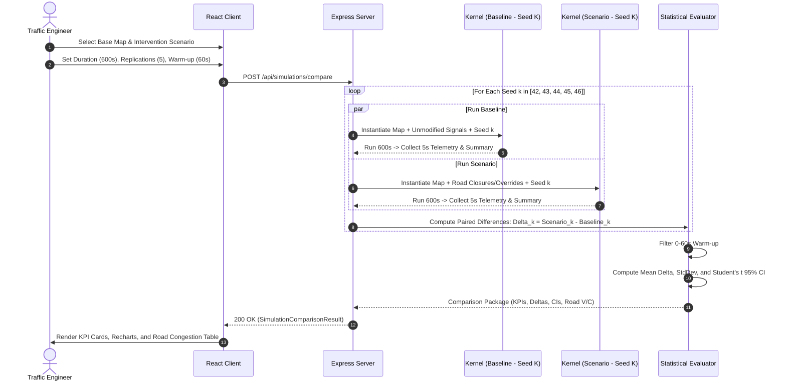

# CitySim: Comprehensive Viva & Engineering Defense Guide

> **Microscopic Urban Traffic Simulation & Decision-Support System**  
> *Prepared for Technical Viva, Architectural Defense, and Academic / Industry Review*

---

## 1. Project Overview & System Purpose

**CitySim** is a full-stack, microscopic multi-agent urban traffic simulator engineered to evaluate transport infrastructure modifications before physical deployment. It empowers traffic engineers and city planners to:
1. **Model** bespoke road networks with arbitrary graph topology, multi-lane roads, priority intersections, and signalized junctions.
2. **Simulate** autonomous vehicle agents with high physical fidelity using continuous car-following and lane-changing differential equations.
3. **Control** intersections using fixed-time cycle controllers and smart adaptive queue-responsive controllers.
4. **Compare** interventions (road closures, signal retiming, capacity expansions, demand surges) against unperturbed baselines using **Common Random Numbers (CRN)** and **paired Student's $t$-test statistical significance**.
5. **Export** decision-grade engineering artifacts, including road-level V/C congestion CSVs, 5-second continuous time-series CSVs, and executive PDF briefing reports.

---

## 2. System Architecture & Diagrams

CitySim is architected into three decoupled modules:
- **`engine/`**: Pure, deterministic, zero-dependency TypeScript simulation kernel. Runs identically in Node.js headless workers, unit test harnesses, and browser background threads.
- **`server/`**: Express.js REST API and Socket.IO WebSocket server orchestrating persistence, headless batch comparisons, multi-seed replications, and real-time streaming.
- **`client/`**: React 18, Vite, Tailwind CSS, Lucide icons, HTML5 Canvas, and Recharts interactive telemetry dashboard.

### 2.1 C4 Container Diagram

```mermaid
graph TD
    User["Traffic Engineer / Planner"]
    
    subgraph BrowserClient["CitySim Frontend (React 18 + Vite)"]
        UI["UI Controls & Dashboard"]
        Canvas["HTML5 Canvas 60 FPS Viewport"]
        Charts["Comparative Recharts & HUD"]
        Report["Executive PDF & CSV Exporters"]
    end

    subgraph BackendServer["CitySim Backend (Express + Socket.IO)"]
        Router["REST API Router (/api/*)"]
        WSServer["WebSocket Server (Socket.IO)"]
        DataStore["DataStore Persistence Layer (JSON/Memory)"]
        BatchOrchestrator["Batch Simulation Orchestrator"]
    end

    subgraph SimulationKernel["Microscopic Simulation Engine"]
        NetworkGraph["RoadNetwork Graph & Spatial Hash"]
        RouterEngine["A* Shortest Path Routing"]
        AgentManager["Vehicle Agent Manager"]
        Physics["IDM Car-Following & Euler Integrator"]
        SignalManager["Webster & Adaptive Signal Controllers"]
        Telemetry["Metrics Collector & Warmup Filter"]
    end

    User -->|Interacts with| UI
    UI -->|Canvas Render| Canvas
    UI -->|Displays Metrics| Charts
    UI -->|Downloads| Report
    
    UI -->|REST Requests| Router
    Canvas <-->|Binary/JSON Frames (20-60 Hz)| WSServer
    
    Router -->|CRUD Maps & Scenarios| DataStore
    Router -->|Trigger Paired Run| BatchOrchestrator
    WSServer -->|Live Step Loop| AgentManager
    BatchOrchestrator -->|Instantiates N Replications| SimulationKernel
    
    AgentManager --> Physics
    AgentManager --> RouterEngine
    NetworkGraph --> AgentManager
    SignalManager --> NetworkGraph
    Physics --> Telemetry
```

### 2.2 Paired Comparison Workflow (Common Random Numbers)



---

## 3. Mathematical & Algorithmic Foundations

### 3.1 Intelligent Driver Model (IDM) Car-Following

The IDM (Treiber, Hennecke, and Helbing, 2000) governs longitudinal vehicle acceleration:

$$\frac{dv}{dt} = a \left[ 1 - \left( \frac{v}{v_0} \right)^\delta - \left( \frac{s^*(v, \Delta v)}{s} \right)^2 \right]$$

Where:
- $v$: Current longitudinal vehicle speed.
- $v_0$: Desired free-flow speed (governed by road segment speed limit).
- $a$: Maximum comfortable acceleration ($1.5 \text{ m/s}^2$).
- $b$: Comfortable deceleration ($2.0 \text{ m/s}^2$).
- $\delta$: Acceleration exponent (typically $\delta = 4$).
- $s$: Current bumper-to-bumper distance to lead vehicle: $s = x_{lead} - x - l_{veh}$.
- $s^*$: Desired dynamical safety headway gap:

$$s^*(v, \Delta v) = s_0 + v T + \frac{v \cdot \Delta v}{2 \sqrt{a b}}$$

- $s_0$: Jam distance / standstill buffer ($2.0 \text{ m}$).
- $T$: Safe time headway ($1.5 \text{ s}$).
- $\Delta v = v - v_{lead}$: Approaching rate (positive when closing in).

#### Physical Safeguards
If the gap collapses ($s < 0.1 \text{ m}$), the model transitions into hard emergency deceleration:
$$a_{veh} = -\max(b_{max}, 2b) \quad (b_{max} = 9.0 \text{ m/s}^2)$$

---

### 3.2 MOBIL Lane-Changing Model

MOBIL (*Minimizing Overall Braking Induced by Lane Changes*, Kesting et al., 2007) governs lateral decisions across multi-lane links. A lane change to candidate lane $c$ is executed if and only if both conditions are met:

1. **Safety Criterion (Prevents rear-end collisions with new follower):**
   $$\tilde{a}_n \ge -b_{safe} \quad (b_{safe} = 4.0 \text{ m/s}^2)$$
   Where $\tilde{a}_n$ is the anticipated acceleration of the new follower in target lane $c$.

2. **Incentive Criterion (Politeness and personal advantage):**
   $$(\tilde{a}_c - a_c) + p \cdot \left[ (\tilde{a}_n - a_n) + (\tilde{a}_o - a_o) \right] > \Delta a_{th}$$
   Where:
   - $\tilde{a}_c - a_c$: Driver's own acceleration gain.
   - $\tilde{a}_n - a_n$: Change in new follower's acceleration.
   - $\tilde{a}_o - a_o$: Change in old follower's acceleration.
   - $p$: Politeness factor ($p = 0.2$).
   - $\Delta a_{th}$: Switching threshold ($0.2 \text{ m/s}^2$) to eliminate high-frequency lane oscillation.

---

### 3.3 Webster's Optimal Signal Timing

Fixed-time signal cycles are initialized via Webster's minimum delay formula:

$$C_0 = \frac{1.5 L + 5}{1 - Y}$$

Where:
- $L$: Total lost time per cycle ($L = \sum (l_i + r_i)$, typically $4 \text{ s}$ per phase).
- $Y$: Critical intersection flow ratio: $Y = \sum_{i} y_i = \sum_{i} \left( \frac{q_i}{S_i} \right)$
  - $q_i$: Arrival flow rate on phase $i$ ($\text{veh/s}$).
  - $S_i$: Saturation flow rate ($\approx 1800 \text{ veh/h/lane} = 0.5 \text{ veh/s/lane}$).

Effective green time for phase $i$ is split proportionally:
$$g_i = (C_0 - L) \cdot \frac{y_i}{Y}$$

---

### 3.4 Numerical Integration: Semi-Implicit Euler

Explicit (Forward) Euler updates position using stale velocity:
$$x_{t+\Delta t} = x_t + v_t \Delta t$$
This is non-symplectic and creates numerical energy expansion in stiff braking, causing vehicles to "quantum tunnel" through red lights or lead bumpers.

CitySim utilizes **Semi-Implicit (Symplectic) Euler**:
$$v_{t+\Delta t} = \max\left(0, v_t + a_t \Delta t\right)$$
$$x_{t+\Delta t} = x_t + v_{t+\Delta t} \Delta t$$

Because the updated velocity $v_{t+\Delta t}$ drives the spatial step, braking takes effect within the exact time step $\Delta t$, ensuring unconditionally stable decelerations at our standard tick step $\Delta t = 0.1 \text{ s}$ ($10 \text{ Hz}$).

---

### 3.5 Routing: A* Pathfinding Admissibility

Vehicle routes are calculated over directed graph $G = (V, E)$ using A* search.
The evaluation function is:
$$f(n) = g(n) + h(n)$$
- $g(n)$: Accumulated travel time from origin: $\sum_{e \in \text{path}} \frac{\text{length}(e)}{v_{limit}(e)}$
- $h(n)$: Heuristic estimate to destination node $D$:

$$h(n) = \frac{\text{EuclideanDistance}(n, D)}{\max_{e \in E} v_{limit}(e)}$$

#### Proof of Admissibility & Optimality
For A* to guarantee the true shortest path:
$$h(n) \le h^*(n) \quad \forall n$$
Since the Euclidean line segment is the shortest physical distance between two 2D points ($\text{dist}_{2D} \le \text{dist}_{road}$), and dividing by the maximum speed in the entire network provides a strict lower bound on traversal time:
$$h(n) = \frac{\text{dist}_{2D}(n, D)}{v_{max}} \le \frac{\text{dist}_{road}(n, D)}{v(e)} = h^*(n)$$
Thus, $h(n)$ is strictly **admissible and monotonic (consistent)**, guaranteeing that the first time node $D$ is extracted from the priority queue, an optimal path has been found.

---

### 3.6 Variance Reduction: Common Random Numbers (CRN)

Traffic simulations exhibit stochastic noise: arrival times, driver headway preferences, and route selections fluctuate across seeds. If Baseline uses Seed $A$ and Scenario uses Seed $B$:

$$\text{Var}(\Delta) = \text{Var}(X_{scenario} - X_{baseline}) = \text{Var}(X_{scen}) + \text{Var}(X_{base}) - 2 \text{Cov}(X_{scen}, X_{base})$$

By forcing **identical pseudo-random seeds (CRN)** across paired runs, the background traffic generation sequence is identical:
$$\text{Cov}(X_{scen}, X_{base}) \gg 0 \implies \text{Var}(\Delta) \ll \text{Var}(X_{scen}) + \text{Var}(X_{base})$$

This isolates the true physical impact of the road closure or signal retiming from stochastic variance.

---

### 3.7 Statistical Significance: Paired Student's $t$-Test

Given $N$ paired replications ($N \in \{1, 3, 5, 10\}$), the paired difference for metric $m$ on seed $i$ is:
$$d_i = X_{\text{scenario}, i} - X_{\text{baseline}, i}$$

The sample mean difference is:
$$\bar{d} = \frac{1}{N} \sum_{i=1}^N d_i$$

Sample standard deviation of differences:
$$s_d = \sqrt{ \frac{1}{N-1} \sum_{i=1}^N (d_i - \bar{d})^2 }$$

The $100(1-\alpha)\%$ Confidence Interval (at $\alpha = 0.05$, 95% two-tailed) with $\nu = N - 1$ degrees of freedom is:
$$\text{CI}_{95\%} = \left[ \bar{d} - t_{\text{crit}} \frac{s_d}{\sqrt{N}}, \quad \bar{d} + t_{\text{crit}} \frac{s_d}{\sqrt{N}} \right]$$

| Degrees of Freedom $\nu = N - 1$ | $t_{\text{crit}}$ (Two-Tailed $\alpha=0.05$) |
|:---:|:---:|
| 1 ($N=2$) | 12.706 |
| 2 ($N=3$) | 4.303 |
| 4 ($N=5$, default) | 2.776 |
| 9 ($N=10$) | 2.262 |

#### Decision Rule:
- If $0 \in \text{CI}_{95\%}$, the observed delta cannot be distinguished from zero noise ($p \ge 0.05$). The UI displays a neutral badge: `Not Significant`.
- If $0 \notin \text{CI}_{95\%}$, the effect is statistically significant ($p < 0.05$). The UI displays green for improvement or red for deterioration.

---

## 4. REST API & WebSocket Protocol Reference

### 4.1 REST Endpoints

| Method | Endpoint | Description |
|:---|:---|:---|
| `GET` | `/api/maps` | List all available road network maps |
| `GET` | `/api/maps/:id` | Retrieve full graph topology (nodes, edges, signals, OD demand) |
| `POST` | `/api/maps` | Persist a newly drawn map from the Canvas Editor |
| `GET` | `/api/scenarios?baseMapId=...` | List scenarios associated with a base map |
| `POST` | `/api/scenarios` | Create a scenario (closures, signal overrides, demand multipliers) |
| `POST` | `/api/simulations/run` | Execute a single headless simulation run |
| `POST` | `/api/simulations/compare` | Execute $N$ paired replications (CRN) with 95% CIs and road V/C |
| `GET` | `/api/simulations/runs` | List persisted historical simulation runs |
| `GET` | `/api/simulations/runs/:id` | Fetch full run details including road congestion and time-series |
| `POST` | `/api/simulations/reports/summary` | Generate executive briefing report metadata |

### 4.2 WebSocket Telemetry (Socket.IO)

- **Client to Server:**
  - `sim:start` `{ mapId, customMap, seed, speedMultiplier }`
  - `sim:pause`
  - `sim:resume`
  - `sim:step`
  - `sim:stop`
  - `sim:set_speed` `{ speedMultiplier }`

- **Server to Client:**
  - `sim:frame` (20 Hz):
    ```json
    {
      "time": 42.5,
      "vehicles": [
        { "id": "veh_12", "x": 385.2, "y": 298.0, "speed": 11.4, "heading": 0.0, "lane": 0, "edgeId": "road_W_C" }
      ],
      "signals": [
        { "nodeId": "node_C", "currentPhase": 0, "state": "GREEN", "timeInPhase": 14.2 }
      ],
      "metrics": {
        "activeVehicles": 18,
        "completedTrips": 45,
        "throughputPerHour": 1820,
        "averageWaitTime": 5.4,
        "meanSpeed": 38.6,
        "congestionBadge": "MODERATE"
      }
    }
    ```

---

## 5. Anticipated Viva Defense Q&A

### Q1: Why did you choose a microscopic model instead of a macroscopic fluid-dynamics model (LWR / Cell Transmission Model)?
> **Answer:** Macroscopic models treat traffic as continuous aggregate fluid flow ($q = k \cdot v$) through conservation of mass ($\frac{\partial k}{\partial t} + \frac{\partial q}{\partial x} = 0$). While computationally fast for entire regional highways, macroscopic models cannot represent individual driver lane changes, vehicle-to-signal interactions, intersection queue dissipation dynamics, or heterogeneous vehicle classes. Because CitySim targets urban intersections, roundabouts, and block closures where individual yielding, deceleration waves, and lane utilization govern network capacity, a microscopic multi-agent model (IDM + MOBIL) is necessary.

---

### Q2: How does your simulation handle cold-start initialization bias?
> **Answer:** Traffic simulations initialized with an empty road network experience an artificial transient phase where delay is zero and throughput is artificially low until vehicles propagate into the network. CitySim incorporates a configurable **60-second warm-up period** (default in Stage 7 and 8). During the first 60 seconds, vehicles spawn, interact, and establish equilibrium queues; all KPI metrics (average stopped delay, hourly throughput, mean travel time) systematically discard metrics collected during $0 \le t \le 60\text{ s}$, ensuring decisions are based purely on steady-state traffic conditions.

---

### Q3: When testing road closures on the 4-way intersection, why did demand drop instead of detouring? How was this resolved?
> **Answer:** In the canonical 4-way intersection (`road_W_C`, `road_S_C`, `road_C_E`, `road_C_N`), `road_W_C` was the sole outgoing link from the western boundary node `node_west`. When `road_W_C` was closed, the origin node had zero outgoing connectivity. Under graph theory, the cut set isolated the origin, making a path to `node_east` mathematically impossible ($d(u, v) = \infty$), forcing the spawner to drop demand (documented in **ADR 034**).  
> To test true detour and spillover dynamics, we designed the **3x3 Urban Grid Network** (9 nodes, 24 directed edges). When the direct arterial `road_ML_C` is severed in the "Center Route Closure" scenario, A* pathfinding discovers alternate perimeter detours (`road_ML_TL -> road_TL_TC -> road_TC_TR -> road_TR_MR`), successfully preserving 100% of trips (64/64 spawned, 0 dropped) and demonstrating real traffic diversion to parallel corridors.

---

### Q4: Why is it necessary to compute a 95% Confidence Interval for deltas rather than simply reporting the mean percentage change?
> **Answer:** In stochastic simulation, a single run might yield an apparent 5% delay reduction purely due to favorable random vehicle arrival gaps under a specific seed. If the standard deviation across seeds is 10%, that 5% improvement is within random noise. By running paired replications under Common Random Numbers and computing a two-tailed Student's $t$ confidence interval $\bar{d} \pm t_{n-1, 0.025} \frac{s_d}{\sqrt{n}}$, we verify whether zero is included in the interval. If $0 \in \text{CI}$, we cannot reject the null hypothesis $H_0: \mu_\Delta = 0$ at $\alpha = 0.05$. This prevents planners from making capital investments on statistically insignificant results.

---

### Q5: Explain the difference between fixed-time and smart adaptive signal controllers in CitySim.
> **Answer:**  
> - **Fixed-Time Signal:** Follows a precomputed, deterministic cycle based on Webster's equation ($C_0$). Green time per approach is invariant regardless of whether vehicles are present, leading to wasted green time during lull periods.  
> - **Smart Adaptive Signal:** Operates as a state machine evaluating real-time approach queues using spatial bounding boxes. If the current phase has served its minimum green time ($g_{min} = 10\text{ s}$) and its queue has emptied while a conflicting approach has vehicles waiting, it immediately transitions through amber ($3\text{ s}$) and all-red ($1.5\text{ s}$) to the conflicting approach. If both approaches are saturated, it serves up to maximum green ($g_{max} = 45\text{ s}$), maximizing green efficiency under unbalanced flows.

---

### Q6: How does CitySim ensure zero division by zero or NaN values when the network has no vehicles?
> **Answer:** We implemented defensive numeric guards in both the engine collector (`MetricsCollector.ts`) and the React HUD (`MetricsOverlay.tsx`):
> 1. Mean speed is computed as $\frac{\sum v_i}{\max(1, N_{active})}$. When $N_{active} = 0$, it explicitly defaults to the road speed limit or $0.0 \text{ km/h}$, never `NaN`.
> 2. Average wait time is guarded by total completed trips: $\frac{\sum \text{delay}_i}{\max(1, N_{completed})}$.
> 3. Congestion level for each edge is computed using density $\rho = \frac{N_{veh}}{L \cdot lanes}$. If $L \le 0$, it clamps to nominal length $1.0\text{ m}$.

---

### Q7: Why do you include a UTF-8 BOM (`\uFEFF`) in exported CSV files?
> **Answer:** Standard CSV files are byte streams. While modern text editors assume UTF-8, Microsoft Excel on Windows defaults to the system ANSI code page (e.g., Windows-1252) unless an explicit Unicode Byte Order Mark (`\uFEFF`) is prepended to the file stream. Without the BOM, Greek symbols and mathematical units used in transportation reports (such as $\Delta$, $\pm$, $\mu\text{s}$, and degree signs) render as corrupted mojibake characters. Including `\uFEFF` guarantees cross-platform integrity in Excel, LibreOffice, and data science notebooks (Pandas/R).

---

### Q8: What prevents vehicles from overlapping during sudden stops?
> **Answer:** Three interlocking mechanisms:
> 1. The IDM non-linear deceleration term $\left( \frac{s^*(v, \Delta v)}{s} \right)^2$ increases asymptotically as gap $s \to 0$.
> 2. Minimum standstill gap parameter $s_0 = 2.0\text{ m}$ enforces a physical buffer.
> 3. Spatial collision clipping in the engine integrator checks if $x_{rear} + v \Delta t > x_{lead} - l_{veh} - 0.5\text{ m}$. If violated, the vehicle is clamped precisely to the bumper buffer distance and velocity is set to 0.

---

### Q9: How is road congestion visualized in the live simulation?
> **Answer:** Road segments are rendered with dynamic color interpolation based on Volume-to-Capacity ($V/C$) ratio and vehicle density:
> - **Green (`#22c55e`, Free Flow):** $V/C < 0.5$, density $< 15\text{ veh/km/lane}$.
> - **Yellow (`#eab308`, Approaching Capacity):** $0.5 \le V/C < 0.85$, density $15 - 35\text{ veh/km/lane}$.
> - **Red (`#ef4444`, Congested):** $V/C \ge 0.85$, density $> 35\text{ veh/km/lane}$.
> - **Dark Gray Dotted (`#475569`):** Closed road link with warning barriers.

---

### Q10: What are the primary performance bottlenecks in microscopic simulations, and how does CitySim mitigate them?
> **Answer:** The primary computational bottleneck in microscopic simulation is the all-pairs proximity check ($O(N^2)$) for car-following and lane-changing lead/lag detection. CitySim optimizes this to $O(N)$ by:
> 1. Partitioning vehicles strictly into sorted 1D arrays per lane per road link ($road\_id \to lane\_index \to [veh_0, veh_1, \dots]$ sorted by longitudinal offset $x$).
> 2. Lead and lag vehicles are resolved in $O(1)$ constant time by index lookup $(i-1)$ and $(i+1)$.
> 3. Conflict points at intersections are resolved via spatial bounding boxes on intersection nodes rather than global collision tests.
> This enables CitySim to simulate hundreds of concurrent vehicles at over 300 FPS in headless mode.
